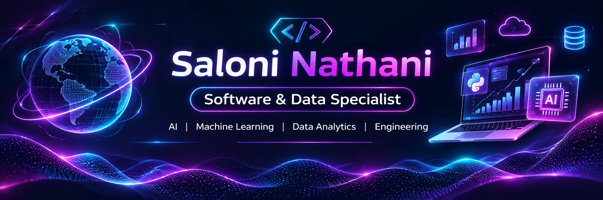
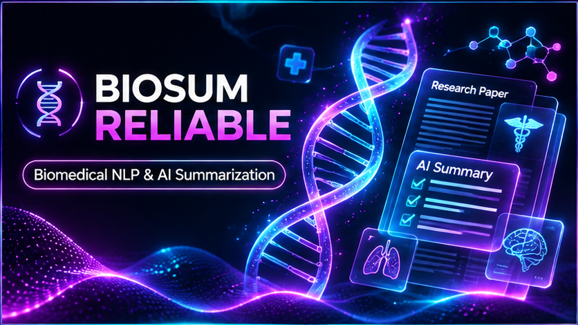
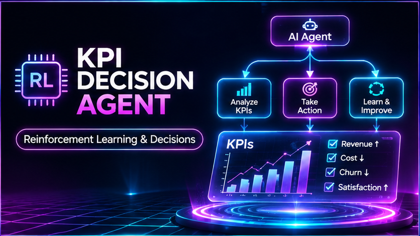
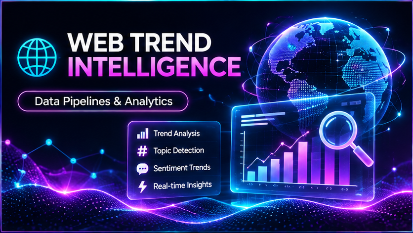
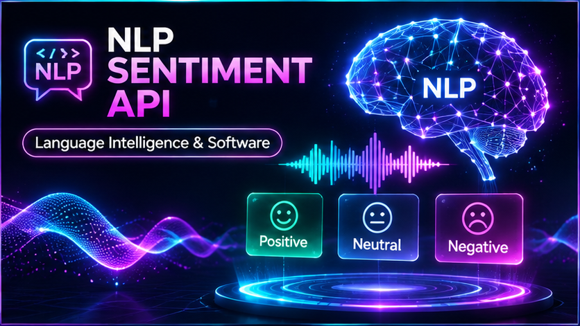

<!-- SALONI NATHANI • NEON INTELLIGENCE LAB -->

<div align="center">



<h1>👋 Hi, I'm Saloni Nathani</h1>
<h3>💜 Software & Data Specialist</h3>


<p><strong>Building intelligent systems that transform data into meaningful, real-world impact.</strong></p>

<a href="https://saloni-1919.github.io/saloni-portfolio/"></a>
<a href="https://www.linkedin.com/in/saloninathani/"></a>
<a href="./Saloni_Nathani_Resume.pdf"></a>

<br/><br/>


</div>

---

## 🌌 About Me

```python
class SaloniNathani:
    role = "Software & Data Specialist"
    education = "MS in Information Systems"
    university = "Pace University"
    focus = ["Software Engineering", "Machine Learning", "Data Analytics", "NLP"]

    @staticmethod
    def mission():
        return "Build intelligent, practical solutions from complex data."
```

- 💻 Building software systems and data-driven applications
- 🧠 Exploring AI, machine learning, NLP, and intelligent automation
- 📊 Turning complex datasets into actionable insights
- ⚙️ Connecting analytics, engineering, and real-world problem solving

---

## ⚡ Technology Universe

<div align="center">

<h3>💻 Programming & Development</h3>


<h3>🤖 AI & Data Science</h3>


<h3>☁️ Cloud & Infrastructure</h3>


<h3>📊 Analytics & Business Intelligence</h3>


</div>

---

## 🧬 Featured Intelligence Systems

<div align="center">
<p><strong>✦ Software × Data × AI — Selected Work ✦</strong></p>

<table>
<tr>
<td width="50%" align="center" valign="top">
<a href="https://github.com/saloni-1919/biosum-reliable"></a>
<h3>🧬 BioSum Reliable</h3>
<p>Biomedical NLP for evidence-backed research summaries, named entity recognition, and transformer-based summarization.</p>
<p><code>Python</code> <code>NLP</code> <code>Transformers</code> <code>FastAPI</code></p>
<a href="https://github.com/saloni-1919/biosum-reliable"></a>
<a href="https://huggingface.co/spaces/saloni-1919/biosum-reliable"></a>
</td>
<td width="50%" align="center" valign="top">
<a href="https://saloni-1919.github.io/saloni-portfolio/"></a>
<h3>🧠 KPI Decision Agent</h3>
<p>Portfolio case study on reinforcement-learning-driven decision intelligence for business KPIs.</p>
<p><code>Python</code> <code>Reinforcement Learning</code> <code>Analytics</code></p>
<a href="https://saloni-1919.github.io/saloni-portfolio/"></a>
</td>
</tr>
<tr>
<td width="50%" align="center" valign="top">
<a href="https://saloni-1919.github.io/saloni-portfolio/"></a>
<h3>🌐 Web Trend Intelligence</h3>
<p>Portfolio case study on data pipelines, trend analysis, and visual exploration of web data.</p>
<p><code>Python</code> <code>Data Pipelines</code> <code>Analytics</code></p>
<a href="https://saloni-1919.github.io/saloni-portfolio/"></a>
</td>
<td width="50%" align="center" valign="top">
<a href="https://saloni-1919.github.io/saloni-portfolio/"></a>
<h3>💬 NLP Sentiment API</h3>
<p>Portfolio case study on text sentiment analysis and an API-based software workflow.</p>
<p><code>Python</code> <code>NLP</code> <code>API</code></p>
<a href="https://saloni-1919.github.io/saloni-portfolio/"></a>
</td>
</tr>
</table>

<p><em>Explore the project case studies in the <a href="https://github.com/saloni-1919/saloni-portfolio">portfolio source repository</a>. Separate repositories for the final three projects have not been confirmed.</em></p>
</div>

---

## 📊 GitHub Intelligence Dashboard

<div align="center">


<br/><br/>

</div>

---

## 🌠 Contribution Galaxy

<div align="center">

</div>

---

## 🐍 Neon Contribution Snake

<div align="center">

</div>

---

## 🛸 Engineering Philosophy

<div align="center">
<h3>“Code with purpose. Analyze with curiosity. Build with impact.”</h3>
<p><strong>Software Engineering × Artificial Intelligence × Data Analytics</strong></p>
<p>I believe the best technology doesn't just process information — it helps people make better decisions, solve meaningful problems, and create lasting value.</p>
</div>

---

## 🌐 Let's Connect

<div align="center">
<h3>✨ Let's Build Something Extraordinary</h3>
<p>Open to opportunities, collaborations, and innovative ideas in software, AI, and data analytics.</p>
<a href="https://www.linkedin.com/in/saloninathani/"></a>
<a href="https://saloni-1919.github.io/saloni-portfolio/"></a>
<a href="mailto:saloninathani19@gmail.com"></a>
<br/><br/>
<p><strong>Thanks for visiting my GitHub universe! 💜</strong></p>
<p><em>Building the future, one intelligent solution at a time.</em></p>
</div>
